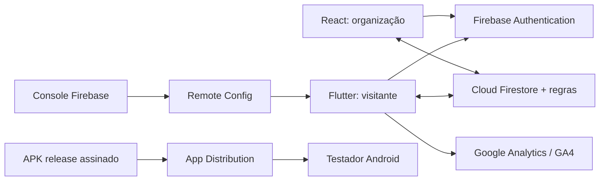

# Circuito de Descobertas

Aplicativo Android e painel administrativo do Amazon Hacking, desenvolvido para Laboratório de Programação Mobile do CESUPA. Incentiva visitantes a conhecer estandes por meio de QR Codes e de uma missão surpresa controlada pelo Firebase Remote Config.

**Situação da entrega (12/11/2026):** o painel passou pelo build de produção e por 19 testes Vitest. O Flutter passou pela análise estática e por 40 testes, gerou APK debug e foi instalado no AVD Android 10, onde carregou os três estandes reais do Firestore. Os testes de domínio adicionais também passaram. A leitura real de QR e o check-in de Amazônia Sustentável foram confirmados no aplicativo e pelo usuário. O APK release 1.0.0 também foi gerado e teve a assinatura verificada com o certificado próprio. Missão em tempo real, GA4, regras no Emulator Suite e o fluxo do App Distribution ainda precisam de validação. Consulte [os resultados e evidências](docs/TESTES.md).

Para quem recebeu a pasta pelo Drive: comece por [COMO_RODAR.md](COMO_RODAR.md). A divisão da gravação entre os três integrantes está em [ROTEIRO_DEMONSTRACAO.md](docs/ROTEIRO_DEMONSTRACAO.md).

## Organização

```text
admin-web/       React, TypeScript, Vite, Firebase JS SDK e QR Code
mobile/          Flutter, Material 3, FlutterFire e scanner CameraX/ML Kit
firebase/        Regras, índices, exemplo Remote Config e testes de segurança
scripts/         Preparação Android, testes sem rede e bootstrap dos emuladores
docs/            Instalação, Firebase, testes, distribuição e roteiro do vídeo
firebase.json    Configuração da CLI e do Firebase Emulator Suite
```

## Para quem recebeu o projeto pelo GitHub

O código fica no GitHub. O responsável envia **`arquivos-locais.zip` separadamente**, apenas aos integrantes. Esse pacote contém as configurações Firebase, a nota de acesso administrativo e os arquivos de assinatura release; não deve ser publicado no repositório.

1. Clone ou baixe o repositório e abra a pasta no VS Code.
2. Extraia o ZIP na raiz do projeto, mantendo a pasta `arquivos-locais/`. A estrutura deve ficar assim:

   ```text
   Circuito-de-Descobertas/
   ├── arquivos-locais/
   │   ├── admin-web/.env.local
   │   ├── mobile/android/app/google-services.json
   │   ├── mobile/android/app/circuito-release.jks
   │   ├── mobile/android/key.properties
   │   ├── mobile/lib/firebase_options.dart
   │   └── docs/ACESSO_LOCAL.md
   ├── scripts/
   └── README.md
   ```

3. Com Node instalado, execute **na raiz**, no PowerShell ou no terminal Linux/macOS:

   ```bash
   node scripts/restaurar-arquivos-locais.mjs
   ```

O comando copia automaticamente os seis arquivos para as pastas corretas. Não requer `npm install`, `firebase login` ou acesso ao console. Pode ser executado novamente quando os arquivos forem iguais; se encontrar uma configuração diferente, interrompe antes de copiar. Para substituí-la intencionalmente, faça backup e execute `node scripts/restaurar-arquivos-locais.mjs --sobrescrever`.

Também é possível informar outra localização do pacote: `node scripts/restaurar-arquivos-locais.mjs "caminho/arquivos-locais"`.

Depois, siga os comandos de execução abaixo. A restauração substitui os passos de preencher `.env.local` e baixar o JSON Android para quem vai usar o mesmo Firebase da equipe. Flutter, Node, Java e Android SDK precisam estar instalados no computador de cada pessoa; `local.properties` não é copiado porque contém caminhos específicos da máquina. O pacote não copia dados do Firestore nem cria usuários: ele conecta ao projeto já existente, sujeito às permissões configuradas.

A pasta `arquivos-locais/`, seu ZIP e os arquivos restaurados estão ignorados pelo Git. Não use `git add -f` para incluí-los. Se algum desses arquivos já tiver sido versionado anteriormente, o `.gitignore` não remove esse histórico automaticamente.

## Execução

Requer Node 24.12 ou superior e Flutter estável 3.47.9 / Dart 3.13.7, Android SDK e JDK compatível. O projeto Android foi gerado pelo SDK Flutter disponível. Não é necessário editar no Android Studio.

1. Siga [CONFIGURACAO_FIREBASE.md](docs/CONFIGURACAO_FIREBASE.md) para registrar as aplicações, configurar o acesso e publicar as regras.
2. Copie `admin-web/.env.example` para `.env.local` e preencha a configuração pública web.
3. Coloque o arquivo Android real em `mobile/android/app/google-services.json`.
4. Execute em terminais diferentes do VS Code:

```bash
cd admin-web
npm install
npm run dev
```

```bash
source scripts/android-env.sh
cd mobile
flutter pub get
flutter devices
flutter run -d emulator-5554
```

No Windows, há equivalentes em PowerShell e um atalho para abrir o AVD: `scripts/start-android.bat`. Consulte os [comandos Windows](docs/INSTALACAO.md) ou o [guia rápido da equipe](COMO_RODAR.md).

O painel abre no endereço informado pelo Vite, normalmente `http://127.0.0.1:5173`. Troque o ID Android pelo resultado de `flutter devices`.

## Administrador da demonstração

O painel conectado ao projeto Firebase utiliza o e-mail **`usuario@gmail.com`**, informado pelo responsável. A senha de acesso está registrada apenas em `docs/ACESSO_LOCAL.md`, arquivo local ignorado pelo Git. A conta precisa existir no Firebase Authentication e seu UID deve ter o documento `admins/{uid}`.

## Funcionalidades implementadas

- Login e persistência de sessão do administrador; autorização adicional em `admins/{uid}`.
- Dashboard com listeners de estandes e check-ins, totais derivados dos documentos e histórico de inativos preservado.
- Cadastro, edição, ativação/desativação e criação idempotente dos três estandes fictícios pelo painel.
- QR exclusivo no formato `circuito://estande/ID`, download PNG e impressão.
- Visitante anônimo persistente, lista de ativos, detalhes, visitas e scanner real com permissão de câmera.
- Transação e ID determinístico `UID_IDESTANDE`; regras negam atualizações e exclusões de visitas.
- Remote Config com padrões seguros, parsing JSON, `onConfigUpdated` e `activate()`, sem polling.
- Eventos centralizados `missao_aberta` e `checkin_concluido`, parâmetro `estande_id`, sem dados pessoais.
- Release exige assinatura própria; credenciais e keystores ficam fora do Git.

## Arquitetura



O identificador Android é `circuito.descobertas`, alinhado ao app registrado no Firebase. O nome do pacote Dart continua `circuito_descobertas`.

O Flutter usa `DiscoveryController` com `ChangeNotifier`, repositório Firestore, serviço de check-in e serviços de Analytics e Remote Config separados. As telas recebem o controller; não há dependência de estado global adicional. A transação consulta estande e visita antes de gravar; o evento Analytics fica fora do callback transacional.

Os IDs dos estandes aceitam letras ASCII, números e hífen, até 128 caracteres. Isso inclui os IDs automáticos do Firestore e os exemplos `robotica`, `amazonia` e `jogos`. As consultas do visitante usam `ativo == true` e `visitanteId == uid`, compatíveis com as regras. Os índices simples automáticos do Firestore bastam.

## Testes

```bash
# Raiz: teste de regras em Firebase Emulator Suite, independente do AVD
npm install
npm run test:rules

cd admin-web
npm test
npm run build

cd ../mobile
flutter analyze
flutter test
flutter build apk --release
```

Há verificações de domínio sem instalação de dependências:

```bash
# Na raiz, com Dart e Python 3 disponíveis
bash scripts/test-core.sh
# Com Node 24
node --disable-warning=ExperimentalWarning admin-web/scripts/test-domain.mjs
```

Esses testes complementam a suíte completa. Não comprovam câmera, regras em servidor, integração Firebase ou Analytics em nuvem.

## Desenvolvimento local sem conta

O modo local usa o **Firebase Emulator Suite real** para Authentication e Firestore. Os dados são documentos no emulador, não listas fixas da interface. Remote Config, Analytics e App Distribution precisam do projeto real e não são simulados.

```bash
# Terminal 1, raiz
npm install
npm run emulators
# Terminal 2, raiz
npm run seed:emulators
# Terminal 3
cd admin-web
VITE_USE_EMULATORS=true npm run dev
# Terminal 4, com AVD aberto
cd mobile
flutter run -d emulator-5554 --dart-define=USE_FIREBASE_EMULATORS=true
```

O bootstrap cria apenas no projeto local `demo-circuito` o administrador `admin@circuito.test`, senha `Circuito-local-2026!`. Depois do login, clique em **Carregar estandes de demonstração** para persistir os projetos fictícios. Nunca utilize essas credenciais no projeto real. O modo local HTTP do Android é permitido somente em debug.

## Documentação

- [Instalação e diagnóstico do ambiente](docs/INSTALACAO.md)
- [Configuração do Firebase e GA4](docs/CONFIGURACAO_FIREBASE.md)
- [Testes, resultados observados e critérios de aceite](docs/TESTES.md)
- [Assinatura, APK e App Distribution](docs/DISTRIBUICAO_APK.md)
- [Vídeo e avaliação de 3,5 pontos](docs/ROTEIRO_DEMONSTRACAO.md)

O projeto utiliza Spark, sem backend próprio, Functions, Cloud Run, Storage ou publicação na Google Play. Observe as cotas gratuitas, especialmente dos listeners Firestore e do Remote Config. As [condições atuais do Remote Config](https://firebase.google.com/docs/remote-config/pricing) incluem cota gratuita no Spark; a demonstração não exige plano Blaze nem cartão.
# Mobile-casseb
